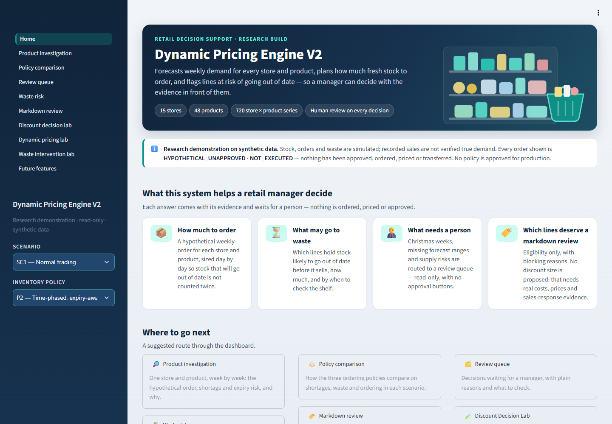
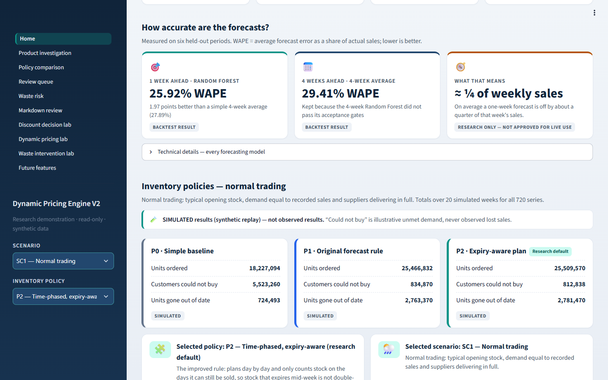
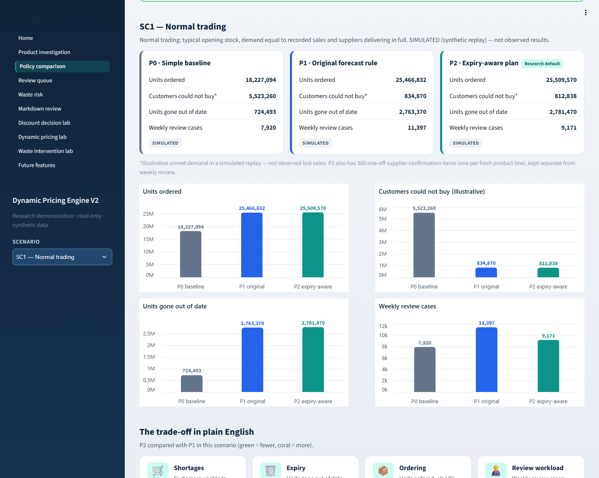
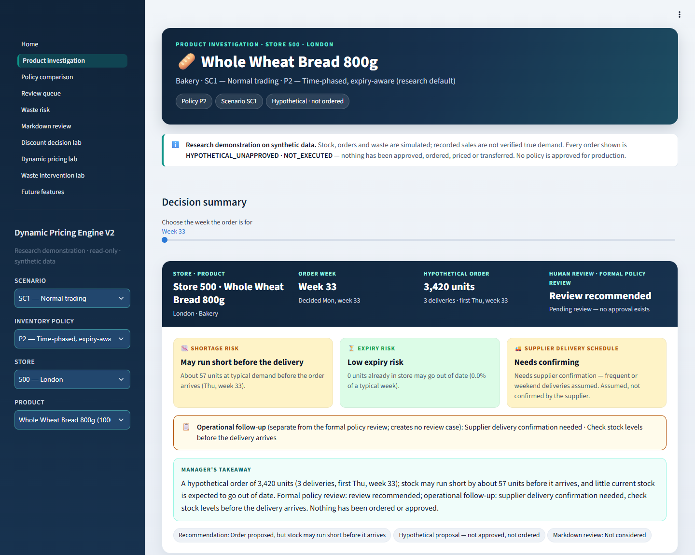
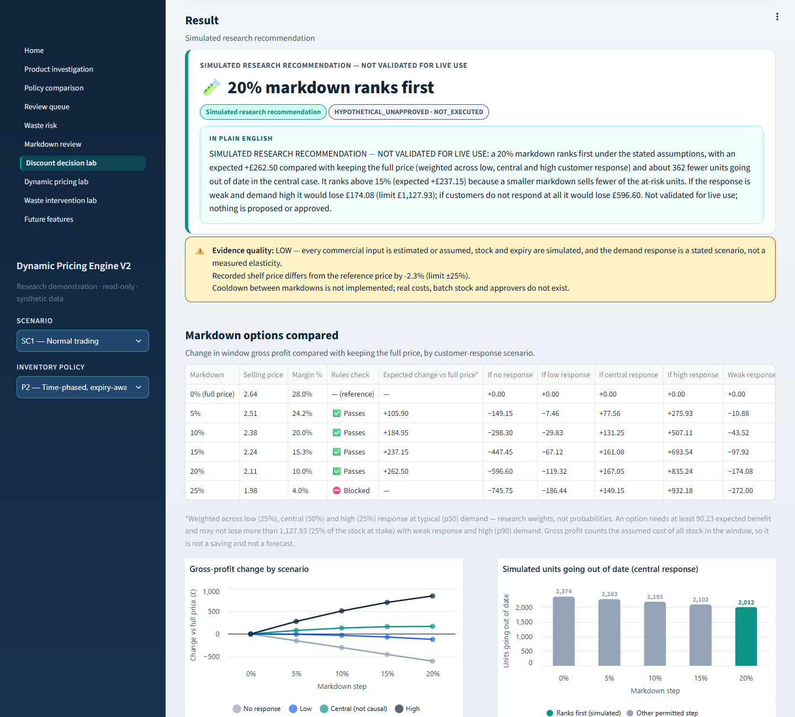
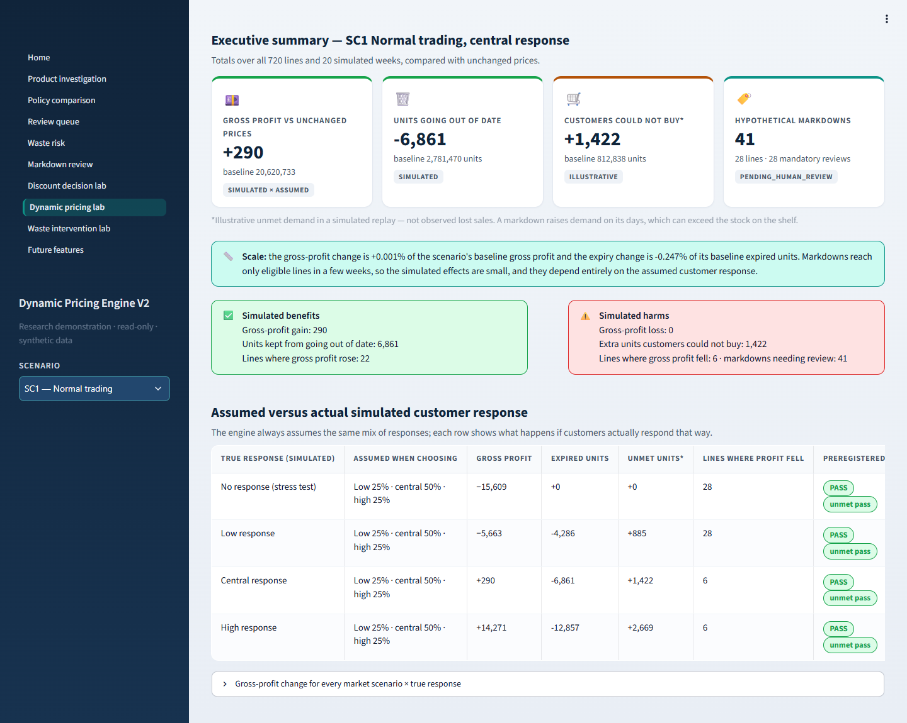
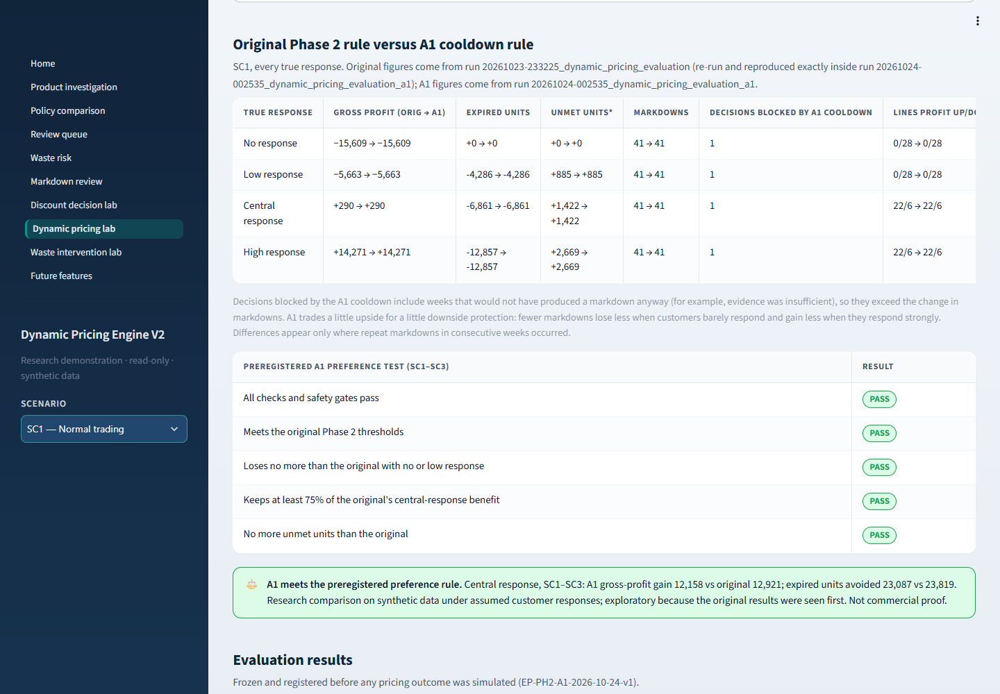
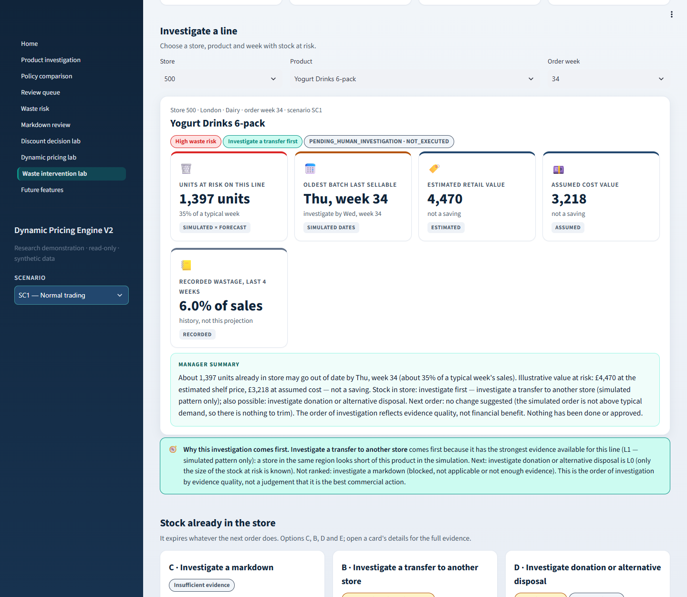

# Dynamic Pricing Engine V2

**Perishable-retail decision support: demand forecasting, expiry-aware inventory simulation, markdown and pricing
research, and waste-intervention analysis. Built in Python with a 10-page Streamlit dashboard, about 714 automated
tests and a SHA-256 integrity registry.**



> **Research demonstration on training data — not for live use.**
> - Stock, expiry and pricing outcomes are **simulated**.
> - Costs are **assumed**, and the customer response to discounts is an **assumed scenario**, not a measured effect.
> - Every order, markdown and intervention is **HYPOTHETICAL_UNAPPROVED · NOT_EXECUTED**.
> - No figure in this repository is a realised business saving or proof of commercial benefit.

---

## Contents

1. [The business problem](#1-the-business-problem)
2. [Business questions the system helps investigate](#2-business-questions-the-system-helps-investigate)
3. [Dataset](#3-dataset)
4. [Data exploration and demand forecasting](#4-data-exploration-and-demand-forecasting)
5. [Inventory simulation: P0 / P1 / P2](#5-inventory-simulation-p0--p1--p2)
6. [Discount Decision Lab](#6-discount-decision-lab)
7. [Dynamic Pricing Lab and the A1 cooldown rule](#7-dynamic-pricing-lab-and-the-a1-cooldown-rule)
8. [Waste Intervention Intelligence](#8-waste-intervention-intelligence)
9. [The 10 dashboard pages](#9-the-10-dashboard-pages)
10. [Architecture and workflow](#10-architecture-and-workflow)
11. [Technologies](#11-technologies)
12. [Installation and running](#12-installation-and-running)
13. [Testing, integrity and reproducibility](#13-testing-integrity-and-reproducibility)
14. [Assumptions and limitations](#14-assumptions-and-limitations)
15. [Skills demonstrated](#15-skills-demonstrated)
16. [Authorship and rights](#16-authorship-and-rights)

---

## 1. The business problem

A grocery retailer selling perishable goods (bakery, dairy, meat, beverages) is caught between three costly mistakes:

- **Ordering too much:** stock goes out of date, causing food waste and lost margin.
- **Ordering too little:** shelves are empty, so customers cannot buy.
- **Discounting badly:** a discount given too late or too deep sacrifices margin without clearing the surplus.

**Objective:** build an explainable, auditable decision-support system that helps a store or category manager
investigate these trade-offs. Every figure carries a label showing whether it is recorded, forecast, simulated or
assumed, and a person stays responsible for every decision.

## 2. Business questions the system helps investigate

- How much is each store likely to sell next week, and how wide is the uncertainty?
- How do three ordering rules compare on shortages, waste, order volume and review workload?
- Which store-product lines have stock likely to expire before it sells, by when, and how much?
- Is a line eligible for a markdown at all? If so, would any discount step beat keeping the full price under stated
  customer-response scenarios?
- What happens over 20 weeks if markdowns are applied, compared with unchanged prices? What if customers do not
  respond?
- Which intervention is worth investigating first for stock at risk, and what evidence or approval is missing?

## 3. Dataset

| Item | Detail |
|---|---|
| Source | Training dataset provided for the **AMDARI Data Science mentorship** (not claimed as the author's property; see [section 16](#16-authorship-and-rights)) |
| Files | `data/raw/weekly_sales.csv`, `product_details.csv`, `store_info.csv`, `supplier_info.csv`, `weather_data.csv` |
| Scope | 37,440 weekly sales rows: 15 stores × 48 products × 52 weeks of 2024 (720 store-product series in 4 categories), with product, store, supplier and weather tables |
| Previous publication | Identical files are public in [Busayosage/predicting_demand_for_perishable_goods](https://github.com/Busayosage/predicting_demand_for_perishable_goods) |
| Nature | Apparently **synthetic or mock** training data, with clear generator patterns (for example, wastage is a fixed ratio of units sold). No personal data. |

**Limitation:** all findings describe this training dataset only. Recorded sales are not verified unconstrained
demand, prices are noisy, and there are no real costs, batch-level stock or causal evidence of how sales respond to
discounts.

## 4. Data exploration and demand forecasting



**Exploration.** The analysis covered:
- trends, seasonality, holidays, promotions, weather and wastage, with data-quality and outlier checks
- diagnostics that showed which relationships come from how the data was generated

**Forecasting.** The original Random Forest was reproduced, then re-evaluated with **leakage-safe rolling backtests**
over six held-out periods. Every feature uses only information available at the forecast date.

| Horizon | Model | WAPE (lower is better) |
|---|---|---|
| 1 week | **Random Forest** (research candidate) | **25.92%** |
| 1 week | 4-week moving average | 27.89% |
| 4 weeks | 4-week moving average (retained) | 29.41% |

- **One week ahead:** the Random Forest passed preregistered acceptance gates, with a +7.07% relative improvement
  (bootstrap 95% interval +5.88% to +8.29%). It was better in 6 of 6 periods, 15 of 15 stores and 4 of 4 categories.
- **Four weeks ahead:** it did **not** pass, so the simpler moving average is kept.
- **Challengers:** XGBoost and CatBoost did not meet the replacement rules.
- **Limitations:** forecast bias was close to the ±10% limit. Sales are not true demand. The forecasts are research
  candidates, not approved for live use.
- **For the decision engines:** a **forecast contract** publishes p10 / p50 / p90 ranges that every engine uses.

## 5. Inventory simulation: P0 / P1 / P2



A deterministic **day-by-day inventory replay** simulates the following over 20 weeks for all 720 series:
- weekly orders, deliveries and supplier lead times
- shelf life and oldest-first selling
- expiry and unmet demand

Units are checked to balance on every simulated day.

| Code | Ordering policy |
|---|---|
| **P0** | Simple historical-sales baseline |
| **P1** | Original forecast-informed rule |
| **P2** | Time-phased, **expiry-aware** plan: stock that will expire before it can be sold is not counted twice |

**Scenarios:** SC1 normal trading, SC2 demand and supply pressure, SC3 excess stock, and SF75 (75% supplier fill).

**Result:** P2 met every preregistered threshold against P1 and is the **research default**. The results are
simulated. P0 orders far less and leaves many more customers unable to buy, but produces less waste, which shows the
trade-off clearly.

The **waste-risk** layer flags lines whose current stock is projected to expire. The **markdown-eligibility** layer
decides whether a markdown is even worth looking at; it is blocked in Christmas weeks, before a shortage, during an
existing promotion, or when too little shelf life remains.



## 6. Discount Decision Lab



For an eligible line, the lab compares every permitted markdown step (5–25%) with keeping the full price. It does this
under four **stated customer-response scenarios**: no response, low, central and high.

- **Checks applied:** evidence gates, a margin floor, a maximum markdown, a minimum-benefit threshold, and a downside
  guard for weak response combined with high demand.
- **Output:** either a **"simulated research recommendation — not validated for live use"** with a plain-English
  explanation, or **NO RECOMMENDATION** with the reason.
- **Customer response is assumed.** The central scenario (+1.6% sales per discount point) is a **non-causal**
  historical association. It is never presented as a proven effect.

## 7. Dynamic Pricing Lab and the A1 cooldown rule



Weekly markdown decisions are simulated **inside** the inventory replay, so a markdown changes stock, expiry and the
decisions that follow.

- **Paired comparison.** Each run is compared with an otherwise identical run at **unchanged prices**.
- **Ordering never changes.** Replenishment orders are fixed, so pricing cannot alter them.
- **Belief and truth are separate.** The engine *assumes* a response mix when choosing a markdown; the simulation then
  applies a stated *true* response (none, low, central or high).
- **Verified baseline.** With pricing switched off, the new simulator reproduces the protected inventory replay
  exactly.
- **Frozen criteria.** Evaluation criteria were frozen before any pricing outcome was simulated.

**Finding (simulated):**
- Gross profit improves only when customers respond to price.
- With no or low response, every marked-down line loses gross profit.
- The effects are small: at most about 0.6% of a scenario's simulated gross profit.

**A1 cooldown rule: preferred research rule, not production approved.** A new markdown may start only after **seven
complete days** since the previous one ended. A separately versioned evaluation found that A1:
- loses less when response is weak or absent
- reduces mandatory reviews
- gives up a little upside when response is strong

The original rule stays selectable for comparison.



## 8. Waste Intervention Intelligence



For each line with stock at risk, it assesses five possible courses of action as **investigation support only**:

| Option | Decision it informs | Highest status it can reach |
|---|---|---|
| A. Review the next order | The **next order** (it cannot save stock already in store) | Candidate for review |
| B. Transfer to another store | Stock in store | **Investigate only** |
| C. Markdown | Stock in store | Candidate for review. Eligibility and sufficient evidence are shown as separate steps |
| D. Donation or disposal | Stock in store | **Investigate only.** Food safety, recipients and costs are never assumed |
| E. No action / insufficient evidence | Stock in store | An honest answer when the evidence cannot support an action |

- **Investigation order:** by **evidence quality**, not by invented financial benefit.
- **Value at risk:** shown as estimated retail value and assumed cost value, never as a saving.

## 9. The 10 dashboard pages

All pages are read-only, with no approval, ordering, pricing, transfer or donation controls.

| Page | What a manager sees |
|---|---|
| **Home** | Data overview, forecast accuracy, policy totals, the decision workflow and navigation |
| **Product investigation** | One store and product week by week: the hypothetical order, shortage, expiry and supplier status, with a plain-English takeaway |
| **Policy comparison** | P0 / P1 / P2 per scenario, the trade-offs, and the frozen acceptance tests |
| **Review queue** | Formal human-review cases, with reasons and what to check |
| **Waste risk** | Lines whose stock may go out of date, with investigate-by dates; recorded, simulated and projected waste kept apart |
| **Markdown review** | Eligibility, blockers, and the evidence still missing before any discount |
| **Discount Decision Lab** | Option comparison under stated response scenarios, with evidence and uncertainty warnings |
| **Dynamic Pricing Lab** | Results against unchanged prices, the assumed-vs-true response matrix, timelines and decision history; A1 is the default, with the original rule selectable |
| **Waste Intervention Lab** | Exposure, value at risk, a manager summary, current-stock and next-order panels, five option cards, an investigation queue and weekly history |
| **Future features** | What is built, and what is deliberately not built |

## 10. Architecture and workflow

```
5 training CSVs ──► verified panel ──► forecasting (RF backtest, acceptance gates, challengers)
                                         │
                                         ▼
                                forecast contract (p10/p50/p90)
                                         │
                                         ▼
                  inventory replay P0 / P1 / P2 × SC1 / SC2 / SC3 / SF75  (protected baseline)
                                         │
                 ┌───────────────────────┼─────────────────────────┐
                 ▼                       ▼                         ▼
           waste risk  ──►  markdown eligibility  ──►  Phase 1 discount engine
                                         │                         │
                                         ▼                         ▼
                      Phase 2 pricing replay (original / A1)  ──►  Phase 3 interventions
                                         │
                                         ▼
                               Streamlit dashboard (read-only)
```

**How the research is kept honest:**
- **Versioned assumptions.** Nine DRAFT assumption sets (`config/assumptions/`); a new rule always means a new
  version.
- **Frozen evaluations.** Evaluation policies (`config/evaluation/`) were frozen before their runs; the decision record
  is in `config/decisions/`.
- **Checksums.** `docs/CHECKSUMS.sha256` holds SHA-256 hashes of 516 protected inputs, policies and outputs.
- **Never overwritten.** Every run writes a new timestamped folder.
- **Full history.** Design notes, results and decisions are in `docs/` and `docs/CHANGELOG.md`.

## 11. Technologies

| Area | Tools |
|---|---|
| Language | Python 3.11 |
| Data and analysis | pandas, NumPy, SciPy, statsmodels |
| Machine learning | scikit-learn (Random Forest), XGBoost and CatBoost (challengers) |
| Visualisation and dashboard | Streamlit, Altair, Matplotlib, seaborn |
| Testing and quality | pytest, pytest-cov, deterministic seeds, SHA-256 integrity registry |
| Data storage | CSV and JSON research runs (no database) |

All versions are pinned in `requirements*.txt`. Each package is under its own licence; see [NOTICE.md](NOTICE.md).

## 12. Installation and running

> **Before you start**
> - The project folder **must be named `dynamic-pricing-engine-v2`**. This is what `git clone` creates by default,
>   and one integrity test checks it.
> - On **Windows**, clone into a **short path**, for example `C:\dev\dynamic-pricing-engine-v2`. Without Windows
>   long-path support, deep folders can make `pip install` or the archive restore fail.

**1. Clone and install (Python 3.11)**

```bash
git clone https://github.com/Busayosage/dynamic-pricing-engine-v2.git
cd dynamic-pricing-engine-v2
python -m venv .venv
```

Activate the environment:
- **Windows:** `.venv\Scripts\activate`
- **macOS / Linux:** `source .venv/bin/activate`

```bash
python -m pip install -r requirements.txt -r requirements-dashboard.txt -r requirements-dev.txt -r requirements-challenger.txt
```

A clean Python 3.11.9 installation was verified end to end on Windows. For Linux x86-64 and macOS (Apple Silicon),
only the availability of every pinned package was checked; the code has not been run on those systems.

**2. Restore the research results**

The dashboard and the full test suite read the saved research results: 484 files, about 933 MB. These are
distributed separately as the release asset `dpe-v2-research-results-1.0.0.zip`.

| File | Size | SHA-256 |
|---|---|---|
| `dpe-v2-research-results-1.0.0.zip` | 65.6 MB | `b02c58d0a2dffe2d18a7c36d5abf37901dd48543587a6e9f419c66cfd4cef2f7` |

```bash
python scripts/restore_research_release.py path/to/dpe-v2-research-results-1.0.0.zip --dry-run
python scripts/restore_research_release.py path/to/dpe-v2-research-results-1.0.0.zip
python scripts/restore_research_release.py --verify-only
```

The restore checks every file against its manifest and `docs/CHECKSUMS.sha256` before placing it. It never
overwrites a differing file without `--force`, and it stops with a clear message on any problem. See
[docs/RESEARCH_RELEASE.md](docs/RESEARCH_RELEASE.md).

**What you can and cannot run without the archive**

| Without the archive | Needs the archive |
|---|---|
| Install the dependencies | The dashboard (9 of its 10 pages read saved results) |
| Read the code, documentation, assumptions and screenshots | The full test suite |
| Run the tests that do not read saved results (see section 13) | Exact reproduction of the published figures |

**Until the release archive is published, the complete dashboard cannot be reproduced from this repository alone.**

**3. Run the dashboard**

```bash
streamlit run app/dashboard/Home.py
```

On Windows you can also double-click `run_dashboard.cmd`. The dashboard opens at <http://localhost:8501>, and the
first load of each analysis page takes about 10–20 seconds.

## 13. Testing, integrity and reproducibility

```bash
python -m pytest
```

| Environment (Windows) | Result |
|---|---|
| Original research environment | **714 passed** |
| Fresh clone with the research archive restored | **711 passed, 3 skipped** |
| Fresh clone without the research archive | **556 passed**; 155 fail or error, because they read saved results that are not present; 3 skipped |

- **About the 3 skips.** They check folders that exist only on the original research computer. Each still verifies
  that writes there are blocked.
- **About the six legacy files.** Six private legacy reference files are not published. Integrity checks treat them as
  optional only when the whole `legacy/` folder is absent.
- **Run time.** The full suite takes about 15 minutes.

**What the tests protect:**
- the forecasting, inventory, pricing and intervention logic
- no look-ahead
- unit conservation
- frozen assumptions and policies
- exact reproduction of protected results
- read-only dashboard behaviour
- byte-identity of every protected file

## 14. Assumptions and limitations

- **Simulation, not observation.** Stock, deliveries, expiry and unmet demand come from the replay. Unmet demand is
  illustrative and never observed lost sales.
- **Assumed commercial inputs.** Margins and costs are assumed. Prices use an estimated reference price, because
  recorded prices are noisy.
- **Customer response is a scenario.** No causal price elasticity exists in the data; results are reported under no,
  low, central and high response.
- **Exploratory evaluations.** Some results were seen before certain evaluation policies were frozen; each policy says
  so.
- **Investigative interventions.** Transfers, donations and disposal lack distance, cost, capacity, batch, safety and
  recipient data, so they remain investigation prompts only.
- **No production approval.** All assumption sets are DRAFT, and A1 is a preferred *research* rule. Nothing is
  executed.

## 15. Skills demonstrated

| Skill area | Evidence in this project | Relevant roles |
|---|---|---|
| Data analysis and data quality | EDA of 37,440 weekly records, data-quality checks, outlier and generator diagnostics, clear limitation statements | Data Analyst |
| Forecasting and evaluation | Leakage-safe backtesting, WAPE / MAE / bias, bootstrap confidence intervals, preregistered acceptance gates, challenger models | Data Analyst, Performance Analyst |
| KPI design and dashboards | A 10-page Streamlit dashboard with KPI cards, comparisons, drill-downs, plain-English summaries and evidence labels | BI Analyst |
| Operations analytics | Inventory simulation, ordering-policy comparison, shortage / waste / workload trade-offs, scenario and stress testing | Operations Analyst |
| Commercial analysis | Markdown, margin and pricing trade-offs, value at risk, downside and sensitivity analysis | Performance Analyst, Commercial Analyst |
| Decision support and governance | Human-in-the-loop design, approval-free read-only outputs, investigation queues, honest "insufficient evidence" outcomes | All analyst roles |
| Reproducible analysis | Versioned assumptions, frozen evaluation criteria, SHA-256 integrity registry, about 714 automated tests, release and restore tooling | All analyst roles |
| Python engineering | A modular package, pandas / NumPy / scikit-learn, pytest, and a cross-platform setup | Data Analyst, BI Analyst |

## 16. Authorship and rights

- **Original code (2025).** The original 2025 perishable-goods forecasting code was written personally by Busayosage
  during the AMDARI Data Science mentorship, under supervision and without AI assistance.
- **V2 (2026).** Dynamic Pricing Engine V2 was then developed under Busayosage's direction, with **AI-assisted
  development and testing**.
- **Dataset.** The AMDARI training dataset was provided for the mentorship and is **not claimed as the author's
  intellectual property**.
- **No licence.** **No MIT or other open-source licence is granted.** Public visibility does not grant permission for
  general or commercial reuse.

Full statement: **[NOTICE.md](NOTICE.md)**. Copyright © 2025–2026 Busayosage. All rights reserved.
